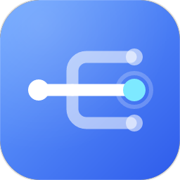
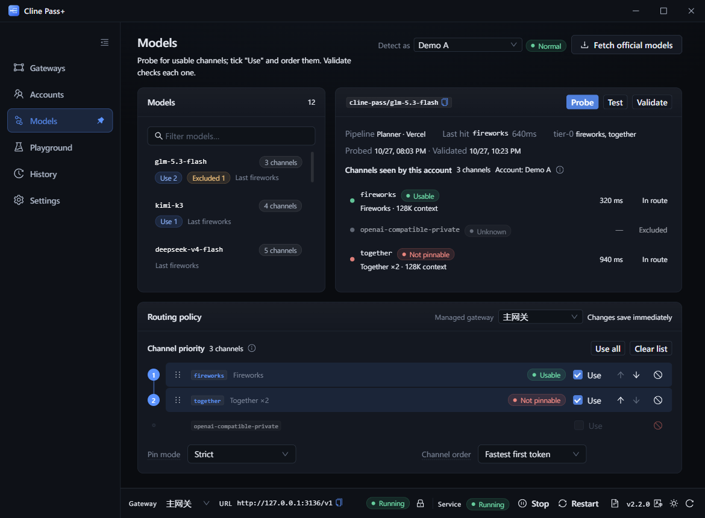

<p align="center">
  
</p>

<h1 align="center">Cline Pass+</h1>

<p align="center">
  <b>Cline Pass Plus</b> · Make the real upstream channels behind your Cline Pass subscription
  visible, pinnable, and failover-ready through a local endpoint.
</p>

<p align="center">
  <a href="README.md">简体中文</a> · <b>English</b>
</p>

<p align="center">
  <a href="../../releases/latest"></a>
  <a href="LICENSE"></a>
  
</p>

<p align="center">
  <a href="#download">Download</a> ·
  <a href="#quick-start">Quick start</a> ·
  <a href="#capabilities">Capabilities</a> ·
  <a href="#how-it-works">How it works</a> ·
  <a href="#configuration">Configuration</a> ·
  <a href="#credits">Credits</a> ·
  <a href="#development">Development</a>
</p>



---

## Download

Installers live on the [Releases](../../releases/latest) page. Pick the package for your OS.

| OS | Recommended | Also available | Notes |
|---|---|---|---|
| **Windows 10/11 (x64)** | [Installer `.exe`](../../releases/latest) | [Portable `.zip`](../../releases/latest) | **Node 22 is bundled.** The portable build runs after extraction and keeps data in the `data/` folder under it. |
| **Ubuntu 22.04+ / Debian 12+** | [`.deb`](../../releases/latest) | — | **Node 22 is bundled.** No separate Node.js install needed. |
| **Fedora 38+** | [`.rpm`](../../releases/latest) | — | **Node 22 is bundled.** No separate Node.js install needed. |
| macOS | Not yet | — | Planned. |

- Linux: `sudo apt install ./cline-pass-plus_*.deb` or `sudo dnf install ./cline-pass-plus-*.rpm`
- Match the file name on the Releases page: Windows `..._x64-setup.exe` (installer) or
  `...-portable.zip` (portable); Ubuntu/Debian `..._amd64.deb`; Fedora `...x86_64.rpm`
- Each release includes `SHA256SUMS.txt`: use `sha256sum -c` on Linux, or
  `Get-FileHash` on Windows
- Upgrades keep the data directory. Uninstalling an installed build keeps it too
  (the config contains keys; remove it manually to erase). Deleting a portable folder
  removes everything.

---

## Quick start

1. **Install and launch.** The Windows installer/portable build opens the console once the
   service is ready; on Linux, launch it from the app menu.
2. **Add an account.** Open **Accounts** → **Add account** and paste a Cline Pass `sk_` key.
   Opening the console locally does not require an extra key.
3. **Probe and pin.** In **Models**, select the account to inspect → **Probe channels** →
   **Validate** → check and order the channels you want. **Playground** can send a minimal
   request as that account to confirm the actual provider.
4. **Connect a client.** On the **Gateways** page, copy the endpoint (default
   `http://127.0.0.1:3126/v1`). Set a downstream API key in the gateway settings if you need
   authentication; it is never displayed again, so reset it if forgotten. The console itself
   lives at `http://127.0.0.1:3125/` and is independent of every gateway: disabling or
   deleting one never takes the console down.
5. **Optional.** In **Settings**, enable start-at-login (desktop app) or adjust the console
   port, bind address and remote access key.

> Data: `%APPDATA%\com.wintervault.clinepass` for the Windows installer,
> `~/.local/share/com.wintervault.clinepass` on Linux. If a `data/` directory exists next
> to the executable, portable mode uses it.

---

## Capabilities

- **Channel visibility**: probe the real upstreams behind subscription models **per account**
  and validate each channel. Results only apply to the account that ran the probe, so two
  accounts never overwrite each other. The actual route is written back to Playground and
  request history.
- **Precise pinning**: separate injection for the planner and direct pipelines. Strict mode
  only uses the listed channels; preferred mode lets only the last candidate fall back to
  the gateway's own choice. Pinning belongs to the gateway; detection belongs to the account.
- **Failover**: errors are classified as account-level, channel-level, or request-level.
  Failing channels sink to the bottom of the list instead of being removed; a global budget
  caps total failover time.
- **Account policies**: sticky (preserves prompt cache), single account, or round-robin,
  with per-gateway account scope (all / normal / risk-flagged / custom) and order.
- **Multiple gateways**: one process can expose several endpoints with independent ports,
  keys, model lists, and routing policies. **The console has its own listener** (3125 by
  default), so a gateway that fails to bind, is disabled, or is deleted never affects it.
- **Local-first**: the console is keyless on the local machine; remote console access and
  `/v1/*` are protected by separate keys. Account keys are returned as masks only,
  gateway keys only as "set / not set", and logs are redacted.
- **Inspectable**: request history records the actual provider, latency, and every attempt;
  Playground shows the candidate order and result step by step.

---

## How it works

```text
Cline / OpenAI-compatible endpoint
        │  /v1/chat/completions
        ▼
  Cline Pass+ ── console (dedicated listener on 3125)
        │
        └── gateway (3126+: port / key / policy)
                    │
                    ├── account pool (sticky / round-robin / scope)
                    └── channel candidates (pin / exclude / cooldown)
                    ▼
           Cline upstream gateway (api.cline.bot)
```

- **Non-stream requests stream internally**: when a client asks for `stream: false`, the
  proxy still requests a stream from upstream and reassembles the JSON. This avoids the
  much slower non-stream path on large contexts.
- **Two-part timeouts**: how long to wait for a response to start (attempt) and how long
  to wait for the next chunk (idle). Long answers are not cut off by total duration.
- **Cancellation is not failure**: if the client disconnects early, the request is not
  recorded as a failure, no channel is cooled down, and no more quota is spent.

---

## Configuration

The config file is `config.json` (version 5). Minimal shape:

```json
{
  "version": 5,
  "accounts": [{ "name": "primary", "key": "sk_..." }],
  "gateways": [{ "id": "main", "name": "Main", "port": 3126 }],
  "console": { "port": 3125, "bindHost": "127.0.0.1", "proxyKey": "" }
}
```

Missing fields are filled in by the schema. See [`config.example.json`](config.example.json)
for the full example. The console `proxyKey` only guards **remote** console access (local
access is always keyless); each gateway's `proxyKey` only guards that gateway's `/v1`.

### Container deployment (optional)

```bash
PROXY_KEY='downstream key' CONSOLE_KEY='console key' docker compose up -d --build
```

The console listens on `3125`; the default gateway on `3126`. When using a reverse proxy,
forward `/v1/*` to `3126` and everything else to `3125` (see
[`deploy/Caddyfile`](deploy/Caddyfile)). The two keys are distinct: `CONSOLE_KEY` guards the
console, `PROXY_KEY` guards client access.

---

## Security and privacy

- **Keys**: `config.json` contains upstream keys in plaintext. The console API returns only
  a mask and the last four characters for accounts, and only "set / not set" for gateway and
  console keys. Logs redact keys and `Authorization`.
- **Local console is keyless**: access is treated as local only when both the peer address
  and the `Host` resolve to loopback. Remote console access uses the console's own key;
  `/v1/*` uses each gateway's key — the two are not interchangeable.
- **No telemetry**: no usage data is uploaded. Account keys are sent only to the Cline
  upstream you configure. OpenRouter catalog requests carry no key.
- **Local data**: request history stores the model, provider, latency, and an error summary;
  it does not store conversation content. On Linux, the data directory is `0700` and config
  and logs are `0600`.

---

## Development

Node.js ≥ 20 is required; the desktop shell also needs Rust (NSIS on Windows).

```bash
npm install
npm test            # vitest, fully mocked, no real network
npm run typecheck
npm run lint
npm run build

npm run dev:isolated      # isolated instance: http://127.0.0.1:3133
npm run desktop:build     # Windows: NSIS + portable zip
npm run desktop:build:linux  # Linux: deb + rpm (must run on Linux)
```

---

## Credits

The design and implementation of this project reference
[munmunjaklin458-afk/cline-pass-switcher](https://github.com/munmunjaklin458-afk/cline-pass-switcher).

---

## License

[MIT](LICENSE)
