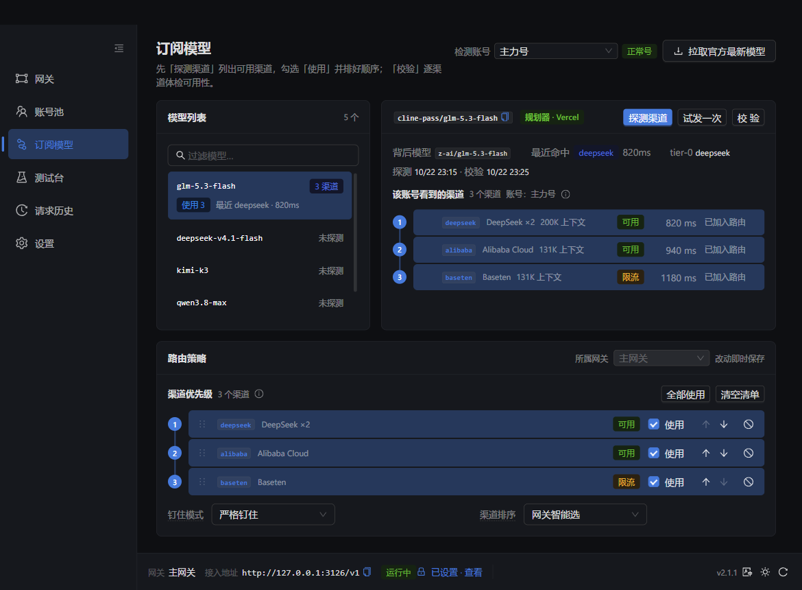

<p align="center">
  
</p>

<h1 align="center">Cline Pass+</h1>

<p align="center">
  <b>Cline Pass Plus</b> · 把 Cline Pass 订阅背后的真实上游渠道，变成可观测、可钉住、可故障转移的本地接入面。
</p>

<p align="center">
  <b>简体中文</b> · <a href="README.en.md">English</a>
</p>

<p align="center">
  <a href="../../releases/latest"></a>
  <a href="LICENSE"></a>
  
</p>

<p align="center">
  <a href="#下载">下载</a> ·
  <a href="#快速开始">快速开始</a> ·
  <a href="#能力">能力</a> ·
  <a href="#工作方式">工作方式</a> ·
  <a href="#配置">配置</a> ·
  <a href="#参考">参考</a> ·
  <a href="#开发">开发</a>
</p>



---

## 下载

安装包都在 [Releases](../../releases/latest) 页面，按系统选择即可。

| 系统 | 推荐下载 | 也提供 | 说明 |
|---|---|---|---|
| **Windows 10/11 (x64)** | [安装版 `.exe`](../../releases/latest) | [便携版 `.zip`](../../releases/latest) | **已内置 Node 22**，无需另装；便携版解压即用，数据在目录下的 `data/` |
| **Ubuntu 22.04+ / Debian 12+** | [`.deb`](../../releases/latest) | — | **已内置 Node 22**，无需另装 |
| **Fedora 38+** | [`.rpm`](../../releases/latest) | — | **已内置 Node 22**，无需另装 |
| macOS | 暂未支持 | — | 计划中 |

- Linux：`sudo apt install ./cline-pass-plus_*.deb` 或 `sudo dnf install ./cline-pass-plus-*.rpm`
- 在 Releases 页面按文件名选择：Windows `..._x64-setup.exe`（安装）或 `...-portable.zip`（便携）；
  Ubuntu/Debian `..._amd64.deb`；Fedora `...x86_64.rpm`
- 每个 Release 附 `SHA256SUMS.txt`：Linux 用 `sha256sum -c`，Windows 用 `Get-FileHash` 对照
- 升级安装会保留数据目录；安装版卸载默认也保留（配置含密钥，需手动删除才会清除）；
  便携版删除整个目录即清除

---

## 快速开始

1. **安装并启动**。Windows 安装版/便携版启动后会先就绪服务再打开控制台；Linux 从应用菜单启动。
2. **添加账号**。打开「账号池」→「添加账号」，填入 Cline Pass 的 `sk_` key。本机打开控制台不需要额外密钥。
3. **探测并钉住**。在「订阅模型」页选择要检测的账号 →「探测渠道」→「校验」→ 勾选渠道并排序。
   「测试台」可以按同一个账号发一次最小请求，确认实际命中的渠道。
4. **接入客户端**。在「网关」页复制接入地址（默认 `http://127.0.0.1:3126/v1`），
   填进 Cline 或任意 OpenAI 兼容客户端；需要鉴权时在网关设置里指定下游 API Key
   （不会回显，忘记可重设）。控制台本身在 `http://127.0.0.1:3125/`，
   与网关完全独立——停用或删除某个网关不会影响控制台。
5. **可选**。在「设置」页开启开机自启（桌面版），或调整控制台的端口、绑定地址与远端访问密钥。

> 数据位置：Windows 安装版为 `%APPDATA%\com.wintervault.clinepass`；
> Linux 为 `~/.local/share/com.wintervault.clinepass`。可执行文件旁存在 `data/` 时进入便携模式。

---

## 能力

- **渠道可见**：按**账号**探测订阅模型背后的真实上游，校验每个渠道是否可用；响应里的实际路由会回写到测试台与请求历史。检测结论只对执行它的账号成立，不会把两个账号的结果混在一起。
- **精确钉住**：区分 planner / direct 两条管道分别注入；严格钉住只走清单，优先+回退只给最后一个候选放开网关选择。钉住属于网关，检测属于账号，两者在界面上分开。
- **故障转移**：错误分账号级 / 渠道级 / 请求级处理；失败渠道冷却沉底而非剔除，全局预算封顶，agent 场景不会久挂。
- **账号策略**：粘性优先（保 prompt cache）、单账号、轮转；按网关设置账号范围（全部 / 正常 / 风控 / 自选）与顺序。
- **多网关**：一个进程多个接入面，端口、密钥、模型清单与路由策略各自独立。**控制台是独立监听**（默认 3125），网关绑不上、被停用或删除都不会连带控制台。
- **本机优先**：本机控制台免密钥；远端访问与 `/v1/*` 受各自的密钥保护；
  账号密钥只回传掩码，网关密钥只回传是否已设置，日志脱敏。
- **可排查**：请求历史记录实际渠道、耗时与每次尝试；测试台能逐步看到候选顺序与结果。

---

## 工作方式

```text
Cline / OpenAI 格式端口
        │  /v1/chat/completions
        ▼
  Cline Pass+ ── 控制台（独立监听 3125）
        │
        └── 网关（3126 起：端口 / 密钥 / 策略）
                    │
                    ├── 账号池（粘性 / 轮转 / 范围）
                    └── 渠道候选（钉住 / 排除 / 冷却）
                    ▼
           Cline 上游网关（api.cline.bot）
```

- **非流式请求内部走流式**：客户端要 `stream:false`，本地仍向上游要流再拼回 JSON，避免大上下文下非流式路径超时。
- **超时分成两段**：多久内要开始有响应（attempt）与连续多久没有新数据（idle），长回答不会被总时长掐断。
- **取消不是失败**：客户端提前断开不记失败、不冷却渠道，也不会继续消耗额度。

---

## 配置

配置文件是 `config.json`（版本 5）。最小结构：

```json
{
  "version": 5,
  "accounts": [{ "name": "主力", "key": "sk_..." }],
  "gateways": [{ "id": "main", "name": "主网关", "port": 3126 }],
  "console": { "port": 3125, "bindHost": "127.0.0.1", "proxyKey": "" }
}
```

未写的字段由 schema 补齐；完整示例见 [`config.example.json`](config.example.json)。
控制台的 `proxyKey` 只用于**远端访问**，本机永远免密钥；网关的 `proxyKey` 只用于该网关的 `/v1`。

### 容器部署（可选）

```bash
PROXY_KEY='下游密钥' CONSOLE_KEY='控制台密钥' docker compose up -d --build
```

控制台在 `3125`，默认网关在 `3126`。反向代理时把 `/v1/*` 转发到 `3126`，其余路径转发到 `3125`
（见 [`deploy/Caddyfile`](deploy/Caddyfile)）。两把密钥不同：`CONSOLE_KEY` 守控制台，
`PROXY_KEY` 守客户端接入。首次启动也可以用 `CLINE_PASS_KEY=sk_...` 注入一个上游账号；
账号池一旦有账号，该变量就会被忽略。

---

## 安全与隐私

- **密钥**：`config.json` 含明文上游密钥；控制台接口对账号只回传掩码与末 4 位，
  对网关/控制台密钥只回传「是否已设置」；日志对 key / Authorization 脱敏。
- **本机控制台免密钥**：判定要求「回环对端 + 回环 Host」同时成立；远端访问控制台使用控制台自己的密钥，
  `/v1/*` 使用各网关的密钥——两把钥匙互不替代。
- **无遥测**：不上报使用数据；账号密钥只发往你配置的 Cline 上游。
  OpenRouter 公开目录请求不携带密钥。
- **本地数据**：请求历史保存模型、渠道、耗时与错误摘要，不保存对话内容；Linux 数据目录 0700、配置与日志 0600。

---

## 开发

要求 Node.js ≥ 20；桌面壳需要 Rust（Windows 另需 NSIS）。

```bash
npm install
npm test            # vitest，全 mock，零真实网络
npm run typecheck
npm run lint
npm run build

npm run dev:isolated      # 隔离实例：http://127.0.0.1:3133
npm run desktop:build     # Windows：NSIS + 便携版
npm run desktop:build:linux  # Linux：deb + rpm（只能在 Linux 上构建）
```


---

## 参考

本项目的设计与实现参考了 [munmunjaklin458-afk/cline-pass-switcher](https://github.com/munmunjaklin458-afk/cline-pass-switcher)。

---

## License

[MIT](LICENSE)
